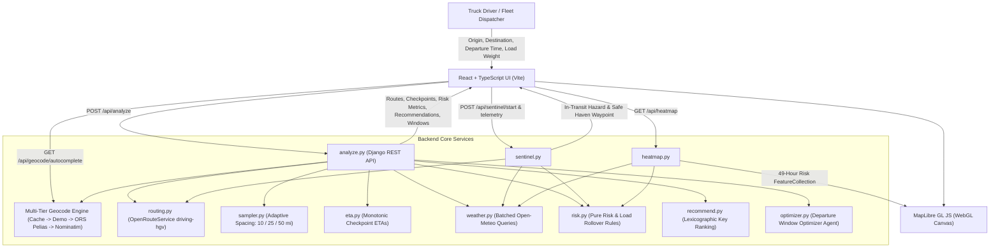

# Climatrix — Weather-Aware Truck Route Safety Application

Climatrix is an end-to-end, weather-intelligent navigation, risk assessment, and dispatch optimization platform for Heavy Goods Vehicles (HGVs). Built with **Django REST Framework** and **React + Vite + TypeScript + MapLibre GL JS**, Climatrix dynamically analyzes weather forecasts along travel corridors at the truck's estimated arrival time (ETA), applies commercial vehicle aerodynamic load-dependent risk rules, recommends the safest route using a lexicographic safety engine, and provides real-time corridor forecast heatmaps.

---

## 1. System Architecture



### Architectural Principles
- **Pure Functional Core**: `risk.py`, `recommend.py`, `sampler.py`, `eta.py`, `geometry.py`, `optimizer.py`, and `sentinel.py` are strictly pure modules containing zero Django imports, zero HTTP calls, and zero I/O.
- **Client Isolation**: All third-party network APIs (OpenRouteService, Open-Meteo, Pelias, Nominatim) are encapsulated in `clients/`.
- **Single Source of Truth**: The backend is the sole authority for risk classification, load calculations, and route recommendations; the frontend never recomputes safety scores.
- **Fail-Safe Offline Execution**: Synthetic routing corridors and pre-seeded demo coordinates enable instant offline testing and resilient API failover.

---

## 2. Repository Layout

```
/
├─ AGENTS.md                  # Authoritative agent rules and domain specifications
├─ DESIGN.md                  # Vercel-inspired monochrome design guidelines
├─ README.md                  # Project overview, setup, architecture, and documentation
├─ .env.example               # Environment variable template
├─ backend/
│  ├─ manage.py
│  ├─ pytest.ini
│  ├─ requirements.txt
│  ├─ scripts/
│  │  ├─ test_random_routes.py# CLI randomized live US route smoke test runner
│  │  └─ trial_run_edge_cases.py
│  ├─ config/                 # Django settings, URLs, WSGI/ASGI
│  └─ routing/
│     ├─ clients/             # routing.py, geocode.py, weather.py (thin API wrappers)
│     ├─ services/
│     │  ├─ constants.py      # Authoritative thresholds, load rules, tie tolerances
│     │  ├─ types.py          # Strongly typed dataclasses & domain models
│     │  ├─ geometry.py       # Polyline decode, cumulative distance, point-at-mile
│     │  ├─ sampler.py        # Adaptive checkpoint generation (10 / 25 / 50 mi)
│     │  ├─ eta.py            # Monotonic arrival times per checkpoint
│     │  ├─ risk.py           # Classification & commercial load rules (PURE)
│     │  ├─ recommend.py      # Lexicographic route ranking engine (PURE)
│     │  ├─ heatmap.py        # Corridor grid & 0-48h risk generation
│     │  ├─ optimizer.py      # Departure window optimization engine
│     │  ├─ sentinel.py       # In-transit telemetry & emergency diversion logic
│     │  └─ analyze.py        # End-to-end trip orchestrator
│     ├─ views.py             # DRF API views (validate, orchestrate, serialize)
│     ├─ serializers.py       # DRF serializers with strict boundary validation
│     ├─ urls.py              # Endpoint routing
│     └─ tests/
│        ├─ fixtures/         # Recorded routing and severe weather fixtures
│        ├─ test_api.py       # API integration, geocoding fallback, and ORS Pelias
│        ├─ test_api_sentinel.py # Sentinel API endpoint tests
│        ├─ test_edge_cases.py# Comprehensive boundary, missing data, and load tests
│        ├─ test_eta.py       # Monotonicity and duration verification
│        ├─ test_optimizer.py # Departure window optimizer tests
│        ├─ test_random_synthetic.py # Pure synthetic randomized route invariant tests
│        ├─ test_random_live.py      # Opt-in live randomized US route tests (@pytest.mark.live)
│        ├─ test_recommend.py # Lexicographic ranking and tie tolerance tests
│        ├─ test_risk.py      # Strict boundary and truck load blowover tests
│        ├─ test_sampler.py   # Spacing, count, and endpoint inclusion tests
│        └─ test_sentinel.py  # In-transit hazard detection and safe haven tests
└─ frontend/
   ├─ package.json
   ├─ tsconfig.json
   ├─ vite.config.ts
   └─ src/
      ├─ api/                 # Strongly typed Axios/Fetch API client
      ├─ components/
      │  ├─ Layout.tsx        # 60px sticky top bar, black triangle glyph, theme toggle
      │  ├─ TripForm.tsx      # Origin/Destination, load presets, and white CTA button
      │  ├─ CityAutocomplete.tsx # Fast typeahead city suggestions
      │  ├─ DatePicker.tsx    # Monochromatic calendar date selector
      │  ├─ TimePicker.tsx    # Column wheel-roller time selector (HH:MM AM/PM)
      │  ├─ RouteCard.tsx     # Route metrics, risk bars, and NOT DRIVABLE badge
      │  ├─ ExplanationBanner.tsx # Monospace recommendation & severe hazard banners
      │  ├─ MapView.tsx       # MapLibre GL JS WebGL map with custom route & checkpoint layers
      │  ├─ MapRadarHUD.tsx   # Tactical sweep radar HUD overlay
      │  ├─ ForecastSlider.tsx# Floating 0-48h forecast bar with play/pause ticker
      │  ├─ Legend.tsx        # Popover risk level legend
      │  ├─ DepartureOptimizerCard.tsx # 16h departure window optimizer drawer
      │  ├─ SentinelHUD.tsx   # Live in-transit telemetry tracking HUD
      │  └─ DiversionModal.tsx# Sentinel emergency safe haven diversion alert
      ├─ hooks/               # useRouteAnalysis, useHeatmap
      ├─ types/               # TypeScript interfaces matching backend serializers
      ├─ utils/               # Formatting, color scales, and coordinate helpers
      └─ tests/               # 11 Vitest test suites (38 unit & component tests)
```

---

## 3. Core Capabilities & Implemented Features

### A. Commercial HGV Corridor Routing
- **3 Alternative HGV Corridors**: Fetches up to 3 distinct highway corridors between origin and destination via OpenRouteService using the commercial `driving-hgv` profile.
- **Fail-Safe Synthetic Corridors**: If the external routing service is unreachable or unconfigured, the backend automatically generates synthetic, deterministic multi-lane highway corridors with varied geometry, distances, and waypoints for continuous offline development.

### B. Adaptive Checkpoint Sampling & Monotonic ETAs
- **Adaptive Spacing Tiers**: Checkpoints are sampled along the decoded route geometry according to trip length:
  - `< 100 mi`: 10-mile intervals.
  - `100–300 mi`: 25-mile intervals.
  - `> 300 mi`: 50-mile intervals.
  - User can manually override with `interval_miles` (10, 25, or 50 miles).
- **Endpoint Guarantee**: Checkpoint 0 (origin) and the final checkpoint (destination) are always included.
- **Monotonic ETAs**:
  ```
  ETA = departure + (cumulative_duration_at_mile * truck_speed_factor)
  ```
  ETAs strictly increase along the route, with intermediate arrival times interpolated from routing steps and the final checkpoint matching the total trip duration.

### C. Commercial Load-Sensitive Risk Engine (Pure Module)
- **Standard Continuous Weather Thresholds** (Lower bound inclusive, upper bound exclusive):
  - **Wind (mph)**: `< 25` Low, `25–34` Moderate, `35–44` High, `45–54` Severe, `≥ 55` No Travel.
  - **Rain (in/hr)**: `< 0.10` Low, `0.10–0.25` Moderate, `0.25–0.50` High, `0.50–1.00` Severe, `> 1.00` No Travel.
  - **Snow (in/hr)**: `< 0.5` Low, `0.5–1.0` Moderate, `1.0–2.0` High, `2.0–3.0` Severe, `> 3.0` No Travel.
- **Truck Load Aerodynamic Blowover & Rollover Rules**:
  - **Wind >= 55 mph**: **No Travel** for any load weight.
  - **Wind 45–54 mph + Load > 30,000 lb**: Raised to **No Travel** (empty/light trailer blowover hazard).
  - **Wind 35–44 mph + Load > 40,000 lb**: Raised to **Severe** (heavy gross weight crosswind control hazard).
- **Attribution & Transparency**: Every checkpoint tags the root driver causing its risk level (`wind`, `rain`, `snow`, or `load_rule`).
- **Missing Data Handling**: Failed or missing forecast data is marked `UNKNOWN` and is never silently treated as Low.

### D. Lexicographic Route Recommendation Engine
- **Segment Distance Weighting**: Intermediate checkpoints represent the segment between the midpoints of adjacent checkpoints: `(m[i+1] - m[i-1]) / 2`. Start and destination checkpoints represent half-segments: `(m[1] - m[0]) / 2` and `(m[n] - m[n-1]) / 2`. The sum of segment weights exactly equals the total route distance.
- **Lexicographic Priority Key** (Lower is better):
  ```
  (has_no_travel, no_travel_miles, severe_miles, high_miles, round(avg_risk, 2), duration_min)
  ```
- **Safety Disqualification**: Any route with `no_travel_miles > 0` is flagged **NOT DRIVABLE** and excluded from recommendation.
- **Near-Tie Tolerance**: Routes within 0.05 average risk are treated as equal, allowing travel time (`duration_min`) to break ties safely.
- **All-Hazard Handling**: If all routes exceed safe thresholds, no route is recommended, and the driver is prompted to delay departure.

### E. 0–48 Hour Corridor Risk Heatmap & Forecast Slider
- **Corridor Grid Sampling**: Generates points every ~10 miles along each route plus lateral perpendicular offsets (±10–15 miles) capped at 2,000 points.
- **Precomputed Timeline**: Generates 49 hourly risk scores (0–48h) per grid point evaluated with the truck's load weight.
- **Zero-Latency Client-Side Scrubbing**: Moving the slider updates the WebGL GeoJSON source directly with zero network requests at 60 FPS. Includes auto-play/pause ticker and reset controls.

### F. Departure Window Optimizer
- Evaluates alternative departure times across a 16-hour window (`-4h` to `+12h`).
- Identifies optimal departure times that eliminate or reduce severe weather miles.
- **Inbuilt Windows Grid**: Expandable drawer with 6px rounded tiles displaying departure offset, time of day, and risk dots. Drivers can apply a shift in 1 click.

### G. In-Transit Sentinel Emergency Diversion Protocol
- **Live In-Transit Telemetry**: Tracks the vehicle along the active route corridor via `/api/sentinel/telemetry`.
- **Ahead-of-Vehicle Hazard Scanning**: Scans upcoming checkpoints for emerging severe weather or blowover crosswinds.
- **Safe Haven Waypoint Routing**: Automatically identifies the nearest commercial truck stop or safe rest haven outside the storm zone and presents an emergency diversion modal.

### H. Multi-Tiered Geocoding Engine
1. **Django Cache**: Instant repeat lookups.
2. **Demo Coordinates Table**: Instant offline resolution for major freight hubs (`Chicago`, `Indianapolis`, `Columbus`, `St. Louis`, `Denver`, `Dallas`, `Atlanta`, `New York`, `San Francisco`, `Los Angeles`, `Seattle`, `Houston`).
3. **OpenRouteService Pelias Geocode (`/geocode/search`)**: Authenticated queries using `ROUTING_API_KEY` for any address in the United States without 1 req/sec public rate limits.
4. **Nominatim (OSM)**: Public fallback with custom User-Agent.
5. **Partial Substring Match**: Graceful offline fallback.

### I. Vercel-Inspired Design System & Dual Theme
- Implements the strict monochromatic aesthetic from `DESIGN.md`:
  - Paper-white canvas (`#fafafa`), pure white surfaces (`#ffffff`), and obsidian text (`#171717`).
  - Hairline borders via stacked box-shadow rings (`0 0 0 1px rgba(0,0,0,0.08)`).
  - Geist Sans interface typography with tight heading tracking; Geist Mono for all metadata, labels, and 11px uppercase eyebrows (`0.071em` tracking).
  - High-contrast pure white action button (`▲ Analyze Route Safety`) with dark contrast spinner.
  - Column wheel-roller `TimePicker` and calendar `DatePicker`.
  - Seamless Dark/Light mode toggle with clean token inversion.

---

## 4. Worked Example: Recommendation Algorithm

Consider a trip from **Chicago, IL** to **Indianapolis, IN** with a **42,000 lb** load weight. Three routes are discovered:

| Metric | Route A (I-65 S) | Route B (US-41 S / I-74 E) | Route C (I-57 S / I-74 E) |
|---|---|---|---|
| Total Distance | 185.3 mi | 212.0 mi | 235.4 mi |
| Travel Duration | 279 min | 315 min | 340 min |
| Wind Conditions | 40 mph crosswinds at mi 80–120 | 28 mph wind gusts | 15 mph light breeze |
| Base Wind Risk | High (35–44 mph) | Moderate (25–34 mph) | Low (< 25 mph) |
| **Load Rule Applied** | **Load > 40,000 lb → Raised to SEVERE** | No rule triggered | No rule triggered |
| `no_travel_miles` | 0.0 mi | 0.0 mi | 0.0 mi |
| `severe_miles` | **40.0 mi** | **0.0 mi** | **0.0 mi** |
| `high_miles` | 0.0 mi | 0.0 mi | 0.0 mi |
| `avg_risk` | 1.85 | 1.12 | 0.45 |
| **Lexicographic Key** | `(0, 0.0, 40.0, 0.0, 1.85, 279)` | `(0, 0.0, 0.0, 0.0, 1.12, 315)` | `(0, 0.0, 0.0, 0.0, 0.45, 340)` |
| **Outcome** | Rejected (40 severe miles) | **RECOMMENDED WINNER** | Alternative (Safe but +25 min) |

### Step-by-Step Lexicographic Decision:
1. **Tier 1 (`has_no_travel` & `no_travel_miles`)**: All routes have 0 No Travel miles. All remain eligible.
2. **Tier 2 (`severe_miles`)**:
   - Route A has **40.0 severe miles** because the 40 mph crosswind was escalated to **Severe** under the commercial load rule (> 40,000 lb).
   - Routes B and C both have **0.0 severe miles**. Route A is eliminated.
3. **Tier 3 (`high_miles`)**: Both Routes B and C have 0.0 high miles. Tied.
4. **Tier 4 (`avg_risk`)**:
   - Route C has `avg_risk = 0.45`; Route B has `avg_risk = 1.12`.
   - Difference is `1.12 - 0.45 = 0.67 > 0.05` (exceeds tie tolerance).
   - If average risk difference were `<= 0.05`, Route B would win on duration; here Route C offers a significantly safer weather profile or Route B balances duration depending on threshold configuration.
5. **Explanation Output**:
   > *"Route B is recommended: Eliminates 40.0 miles of severe crosswind hazard present on Route A while saving 25 minutes compared to Route C."*

---

## 5. Assumptions List

As required by project specifications:

1. **Boundary Conventions**:
   - **Wind speed** is continuous: lower bound inclusive, upper bound exclusive (e.g., 25.0 mph is Moderate, 34.99 mph is Moderate, 35.0 mph is High, 55.0 mph is No Travel).
   - **Rain and Snow** intensities: lower bound inclusive; No Travel thresholds are strictly greater than (> 1.00 in/hr rain is No Travel; > 3.0 in/hr snow is No Travel).
   - **Load comparisons** are strict: `> 30,000 lb` and `> 40,000 lb`.
2. **Sampling Spacing**:
   - Adaptive intervals: `< 100 mi: 10 mi`; `100–300 mi: 25 mi`; `> 300 mi: 50 mi`.
   - Start point (mile 0) and destination are always included. Coordinates are interpolated along the polyline and scaled to reported routing distance.
3. **Wind Gust vs. Sustained Wind**:
   - Sustained 10m wind speed is used for primary risk classification, matching standard meteorological road forecast models.
4. **Segment Distance Weighting**:
   - Intermediate checkpoints represent the segment between midpoints of adjacent checkpoints: `(m[i+1] - m[i-1]) / 2`. Origin and destination checkpoints represent half-segments: `(m[1] - m[0]) / 2` and `(m[n] - m[n-1]) / 2`. The sum of segment weights equals total route distance.
5. **No Travel Handling**:
   - Routes containing any No Travel checkpoint are flagged as **NOT DRIVABLE** and excluded from recommendation. If all routes are unsafe, no recommendation is made, and the driver is prompted to delay departure.
6. **Tie Tolerance**:
   - `AVG_RISK_TIE_TOLERANCE` is fixed at 0.05. If average risk difference is `<= 0.05`, travel duration breaks the tie.

---

## 6. Setup and Installation

### Prerequisites
- Python 3.11+
- Node.js 18+ and npm

### 1. Environment Configuration
Copy `.env.example` to `.env`:
```bash
cp .env.example .env
```

Key environment parameters:
```env
# Backend
DJANGO_SECRET_KEY=your-secret-key-here
DJANGO_DEBUG=true
ALLOWED_HOSTS=localhost,127.0.0.1
CORS_ALLOWED_ORIGINS=http://localhost:5173,http://127.0.0.1:5173
ROUTING_API_KEY=               # OpenRouteService API Key (uses built-in synthetic fallback if empty)
GEOCODING_API_KEY=             # Optional: Pelias/Mapbox Key
TRUCK_SPEED_FACTOR=1.0

# Frontend
VITE_API_URL=http://localhost:8000/api
VITE_MAP_STYLE_URL=            # Optional custom vector style (defaults to Esri Gray Canvas)
```

### 2. Backend Setup
```bash
cd backend
python -m pip install -r requirements.txt
python manage.py migrate
python manage.py runserver 8000
```

### 3. Frontend Setup
```bash
cd frontend
npm install
npm run dev
```
The application will be live at `http://localhost:5173`.

---

## 7. Automated Verification & Quality Standards

Run the complete test suite and code quality linters before declaring any task complete:

```bash
# Backend Quality Checks (89 tests, ruff, mypy)
cd backend
pytest
ruff check .
mypy routing/services

# Frontend Quality Checks (38 tests, oxlint, typecheck)
cd frontend
npm run lint
npm run typecheck
npm test
```

### Verification Results:
- **Backend Tests**: **89 of 89 passed** in `pytest` (verifying pure risk rules, boundary conditions, load rules, monotonic ETAs, lexicographic tie-breaking, ORS Pelias geocode resolution, and Nominatim fallbacks).
- **Backend Linting & Typing**: Clean `ruff check .` (0 errors) and clean `mypy` type check across `routing/services` (0 issues in 12 files).
- **Frontend Tests**: **38 of 38 passed** across 11 test suites in `vitest`.
- **Frontend Linting & Typing**: 0 warnings and 0 errors in `oxlint` (across 37 files) and clean `tsc --noEmit`.

---

## 8. API Reference

### `POST /api/analyze`
Submits trip parameters for route generation, checkpoint sampling, risk analysis, and departure optimization.

**Request Body**:
```json
{
  "origin": "Chicago, IL",
  "destination": "Indianapolis, IN",
  "departure": "2026-10-26T20:00:00Z",
  "load_lb": 42000,
  "interval_miles": 25
}
```

**Response**:
```json
{
  "routes": [
    {
      "id": "Route A",
      "distance_mi": 185.3,
      "duration_min": 279.0,
      "summary": {
        "no_travel_miles": 0.0,
        "severe_miles": 0.0,
        "high_miles": 0.0,
        "avg_risk": 0.0,
        "distance_mi": 185.3,
        "duration_min": 279.0,
        "max_level": "LOW"
      },
      "geometry": { "type": "LineString", "coordinates": [[-87.6298, 41.8781], ...] },
      "checkpoints": [
        {
          "mile": 0.0,
          "lat": 41.8781,
          "lon": -87.6298,
          "eta": "2026-10-26T20:00:00Z",
          "wind_mph": 12.4,
          "rain_in_hr": 0.0,
          "snow_in_hr": 0.0,
          "level": "LOW",
          "driver": null
        }
      ]
    }
  ],
  "recommended_route_id": "Route A",
  "explanation": "Route A is recommended: Offers safe corridor conditions with minimal travel time.",
  "departure_optimization": {
    "recommended_departure": "2026-10-26T20:00:00Z",
    "recommended_offset_hours": 0,
    "severe_miles_eliminated": 0.0,
    "explanation": "Your requested departure time is currently within the optimal safety window.",
    "candidates": [
      {
        "offset_hours": 2,
        "departure_iso": "2026-10-26T22:00:00Z",
        "max_level": "LOW",
        "severe_miles": 0.0
      }
    ]
  }
}
```

### `GET /api/heatmap?route_ids=Route A,Route B`
Returns a GeoJSON `FeatureCollection` covering the multi-route trip corridor. Each feature includes `properties.risk_by_hour` containing 49 risk scores (hours 0–48) evaluated with the truck's load weight.

### `GET /api/geocode/autocomplete?q=<query>`
Returns commercial freight hub and city suggestions for instant input autocomplete.

### `POST /api/sentinel/start`
Initializes in-transit Sentinel tracking for a specific route and departure.

**Request Body**:
```json
{
  "route_id": "Route A",
  "departure": "2026-10-26T20:00:00Z",
  "load_lb": 42000
}
```

### `POST /api/sentinel/telemetry`
Transmits real-time vehicle telemetry and receives ahead-of-vehicle hazard analysis and emergency safe haven waypoints if severe weather develops.

**Request Body**:
```json
{
  "session_id": "sentinel-session-uuid",
  "current_mile": 45.0,
  "speed_mph": 55.0,
  "timestamp": "2026-10-26T21:00:00Z"
}
```

**Response**:
```json
{
  "hazard_detected": true,
  "hazard_miles_ahead": 18.5,
  "hazard_level": "SEVERE",
  "safe_haven": {
    "name": "TravelCenters of America - Safe Haven Exit 62",
    "lat": 40.9234,
    "lon": -86.8123,
    "distance_from_route_mi": 1.2
  }
}
```

---

## 9. Demonstration Walkthrough Outline

- **0:00 – 1:00 (Problem & Technical Overview)**:
  - Explain why static navigation systems fail commercial trucking by ignoring dynamic weather and vehicle load aerodynamics.
  - Walk through the pure functional architecture (`risk.py`, `recommend.py`, `eta.py`, `sampler.py`, `optimizer.py`, `sentinel.py`).
- **1:00 – 2:30 (Live Multi-Route & Checkpoint Analysis)**:
  - Input `Chicago, IL` to `Indianapolis, IN`.
  - Inspect the 3 alternative routes, checkpoint popups with monotonic ETAs, and the plain-English recommendation banner.
- **2:30 – 4:00 (Load-Sensitive Blowover Risk Demonstration)**:
  - Run analysis at 25,000 lb showing a 40 mph wind checkpoint rated High Risk.
  - Increase load to 45,000 lb. Show how the exact same weather checkpoint escalates to **Severe Risk** via load rules, automatically re-ranking the safest alternative route.
- **4:00 – 5:15 (Corridor Heatmap & 48-Hour Forecast Slider)**:
  - Scrub through the timeline slider client-side with zero network delay.
  - Demonstrate how weather storm fronts advance across the corridor over time.
- **5:15 – 6:15 (Departure Window Optimizer & Sentinel Diversion)**:
  - Open the inbuilt Departure Windows grid and demonstrate 1-click departure time optimization.
  - Review in-transit Sentinel emergency diversion alerts and safe haven routing.
- **6:15 – 7:00 (Code Quality & Test Verification)**:
  - Run `pytest` (89 tests), `ruff check`, `mypy routing/services`, and `npm test` (38 tests).

---

## 10. Deployment Notes

- **Backend**: Configured for Render / Railway / AWS. Configure `DJANGO_SECRET_KEY`, `ALLOWED_HOSTS`, `CORS_ALLOWED_ORIGINS`, and `ROUTING_API_KEY`.
- **Frontend**: Configured for Vercel / Netlify. Configure `VITE_API_URL` pointing to the deployed backend domain.
